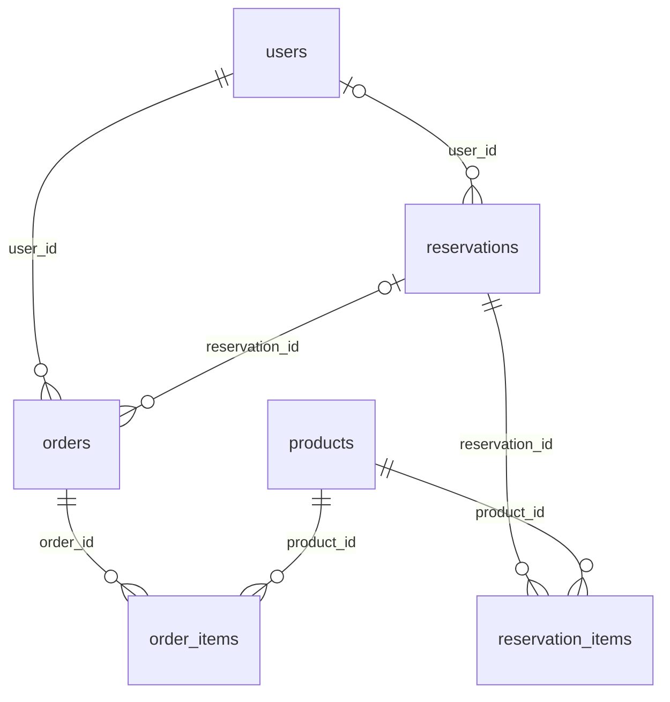

# 현재 DB 구조

확인일: **2026-11-03 (KST)**. 기준 코드는 [server/db.py](../server/db.py)의 `SCHEMA`, 데이터 처리 코드는 [server/app.py](../server/app.py), 상품 규칙은 [server/catalog.py](../server/catalog.py)입니다.

소스 DDL로 만든 메모리 DB, 현재 로컬 미리보기 DB, 공개 Oracle 서버 DB의 **컬럼·기본값·기본키·외래키·CHECK·인덱스 메타데이터가 일치**하는 것을 확인했습니다. 애플리케이션 테이블은 **16개**, 컬럼은 **93개**, 실제 외래키는 **16개**, CHECK 제약은 **21개**, 코드에서 명시적으로 생성하는 조회용 인덱스는 **4개**입니다. SQLite 내부 테이블 `sqlite_sequence`와 PK·UNIQUE용 자동 인덱스는 이 테이블·조회용 인덱스 개수에서 제외합니다.

## 1. 실행 환경과 저장 위치

| 환경 | 현재 엔진 | DB 위치 |
| --- | --- | --- |
| 로컬 미리보기, 포트 8011 | SQLite, WAL 모드 | 레포의 `data/shared-inventory-preview.sqlite3` |
| 공개 가안, Oracle API | SQLite, WAL 모드 | `/var/lib/bbang-palja/prototype.sqlite3` |
| 환경 변수 없이 기본 실행 | SQLite | 레포의 `data/kambodelight.db` |

로컬과 공개 DB는 **서로 다른 데이터**를 저장합니다. 소스 push나 프론트 배포로 로컬 계정·주문·예약이 공개 DB에 복사되지는 않습니다. Cloudflare Pages는 프론트 파일을 제공하고, DB 접근은 Oracle에서 실행되는 Python API가 담당합니다.

`DATABASE_URL`에 `postgres://` 또는 `postgresql://` 주소가 있으면 psycopg 기반 PostgreSQL 어댑터를 사용합니다. 현재 공개 서버에는 이 연결을 사용하지 않습니다. PostgreSQL 초기화 시 자동 증가 ID 선언은 `BIGSERIAL PRIMARY KEY`로 바꾸지만, 나머지 기본 스키마는 같은 `SCHEMA`를 사용합니다. 날짜와 JSON 저장 컬럼도 현재 코드에서는 `TEXT`입니다. 현재 자동 배포의 DB 백업은 SQLite용이며 PostgreSQL 전환은 별도 배포 작업입니다.

## 2. 테이블 전체 목록

| 영역 | 테이블 | 저장하는 것 |
| --- | --- | --- |
| 계정 | `users` | 구매자·담당자 계정, 점수, 남은 주사위, 보상 수령 횟수 |
| 인증 | `sessions` | 로그인 토큰의 해시와 만료 시각 |
| 상품·재고 | `products` | 빵·우유 정보와 현판·예판 재고 |
| 재고 이력 | `inventory_logs` | 품목별 재고 증감, 사유, 처리자 이름 |
| 예판 | `reservations` | 예약자 이름·전화번호, 수령 상태, 연결 계정·주문 |
| 예판 항목 | `reservation_items` | 예약한 상품·수량·예약 당시 가격 |
| 예판 인증 | `preorder_verifications` | 구매자가 이름·전화번호를 확인한 예약의 조회 유효기간 |
| 주문 | `orders` | 현장 구매·예판 수령·수기 판매 주문과 승인 상태 |
| 주문 항목 | `order_items` | 주문 당시 상품명·가격·수량 |
| 주사위 | `dice_rolls` | 주사위를 굴린 사용자와 결과 |
| 빵 보상 | `rewards` | 당첨 상품과 보상 기준 점수 |
| 인스타 인증 | `events` | 사용자별 인증 및 우유·주사위 지급 내역 |
| 운영 메모 | `memos` | 인수인계 내용과 작성자 이름 |
| 담당 시간표 | `schedule` | 담당 팀·시간·역할 표시용 정보 |
| 내부 설정 | `settings` | 초기 데이터 준비 여부, 이전 우유 재고 호환 값 |
| 중복 요청 방지 | `idempotency` | 같은 요청의 중복 실행을 막기 위한 요청 식별자·응답 |

## 3. 핵심 관계

아래는 주문·예약·상품의 실제 외래키 관계입니다. `o|` 쪽은 연결이 없어도 되는 관계이고, `o{` 쪽은 여러 행이 연결될 수 있음을 뜻합니다.

`reservations.order_id`는 현재 접수·완료 주문을 가리키는 **코드상의 연결**이며, DDL에 `REFERENCES orders(id)`가 선언되어 있지는 않습니다. 반대편 `orders.reservation_id`는 실제 외래키입니다.

예약을 접수했다가 취소하고 다시 접수하면 한 예약에 여러 과거 주문이 남을 수 있습니다. 현재 활성 주문은 `reservations.order_id`로 관리합니다. `orders.reservation_id`에 UNIQUE 제약은 없으며 활성 주문 중복 방지는 애플리케이션의 쓰기 잠금과 상태 검사로 처리합니다.

## 4. 컬럼 상세

표의 `NN`은 DDL의 `NOT NULL`, `PK`는 기본키, `FK`는 실제 외래키, `NULL 허용`은 선택 컬럼입니다. `기본값 —`에 해당하는 컬럼은 앱이 값을 넣습니다. 일반적인 `id`는 자동 증가 정수이며 `products.id`만 카탈로그에서 고정 번호를 지정합니다.

시각은 UTC ISO 8601 문자열로 저장합니다. 앱의 기록 시각은 밀리초 정밀도이며 화면에서는 브라우저의 현지 시간대로 표시합니다. 금액은 원 단위 정수, 수량은 상품의 판매 단위입니다.

### 4.1 `users` — 계정과 게임 집계

| 컬럼 | 타입 | 제약·기본값 | 의미 |
| --- | --- | --- | --- |
| `id` | INTEGER | PK, 자동 증가 | 사용자 번호 |
| `name` | TEXT | NN | 로그인 이름 |
| `role` | TEXT | NN, `buyer` / `staff` | 구매자 또는 담당자 |
| `password_hash` | TEXT | NN | 구매자 PIN 해시. 담당자 행은 빈 문자열 |
| `score` | INTEGER | NN, 기본 0, 0 이상 | 누적 주사위 점수 |
| `dice_balance` | INTEGER | NN, 기본 0, 0 이상 | 아직 사용하지 않은 주사위 |
| `rewards_claimed` | INTEGER | NN, 기본 0, 0 이상 | 성공적으로 받은 랜덤 빵 보상 횟수 |
| `created_at` | TEXT | NN | 계정 생성 시각 |

- `UNIQUE(name, role)`: 같은 역할 안에서는 이름이 중복될 수 없습니다. 구매자와 담당자가 같은 이름인 것은 가능합니다.
- 구매자 PIN은 숫자 네 자리이며 PBKDF2-HMAC-SHA256, 임의 salt, 160,000회 반복으로 저장합니다.
- 담당자 공용 비밀번호는 이 테이블에 저장하지 않고 `STAFF_PASSWORD` 환경 변수로 확인합니다.
- 전화번호는 사용자 테이블에 없습니다. 예약자의 전화번호는 `reservations.phone`에 있습니다.
- 캐릭터 레벨은 별도 컬럼 없이 `min(5, rewards_claimed)`로 계산합니다.

### 4.2 `sessions` — 로그인 세션

| 컬럼 | 타입 | 제약·기본값 | 의미 |
| --- | --- | --- | --- |
| `token_hash` | TEXT | PK | 발급 토큰의 SHA-256 해시 |
| `user_id` | INTEGER | NN, FK → `users.id` | 로그인한 계정 |
| `expires_at` | TEXT | NN | 만료 시각 |

세션은 발급 시점부터 7일간 유효합니다. 새 로그인 시 만료된 세션을 삭제하고, 로그아웃 시 해당 토큰의 행을 삭제합니다. 원본 토큰은 발급 응답으로 전달하며 DB에는 해시를 저장합니다.

### 4.3 `products` — 품목과 재고

| 컬럼 | 타입 | 제약·기본값 | 의미 |
| --- | --- | --- | --- |
| `id` | INTEGER | PK, 고정 번호 | 상품 번호 |
| `name` | TEXT | NN | 실제 메뉴 이름 |
| `subtitle` | TEXT | NN | 연금술 컨셉 이름 |
| `price` | INTEGER | NN, 0 이상 | 현재 판매 단가 |
| `stock` | INTEGER | NN, 0 이상 | 현재 현판 판매·이벤트 지급에 쓸 수 있는 재고 |
| `preorder_stock` | INTEGER | NN, 기본 0, 0 이상 | 아직 수령 요청으로 확보하지 않은 예판 대기 재고 |
| `reward_stock` | INTEGER | NN, 기본 0, 0 이상 | 이전 별도 이벤트 재고 컬럼. 현재는 0으로 통합 종료 |
| `category` | TEXT | NN | 휘낭시에·타르트·음료 등 분류 |
| `image` | TEXT | NN | 컨셉 SVG 이미지 식별자 |

현재 판매 목록은 카탈로그의 101~112번입니다. 우유는 112번이며 2,000원입니다. 이전 메뉴 번호가 DB에 남아 있어도 현재 판매 목록에서 제외할 수 있고, 과거 주문·예약의 참조는 보존합니다.

도넛 108번은 5개 한 세트가 재고 1단위입니다. 판매 단위 `unit`, 실물 사진 경로 `photo`, 주사위 지급 단위 `dice_per_unit`, 추첨 대상 여부 `reward_eligible`은 API에서 카탈로그를 기준으로 붙이는 값이며 DB 컬럼이 아닙니다. 실물 사진 파일은 `frontend/assets/photos/`, 매핑은 `PRODUCT_PHOTOS`에서 관리합니다.

### 4.4 `reservations` — 예판 예약과 수령 연결

| 컬럼 | 타입 | 제약·기본값 | 의미 |
| --- | --- | --- | --- |
| `id` | INTEGER | PK, 자동 증가 | 예약 번호 |
| `name` | TEXT | NN | 원래 예약자 이름 |
| `phone` | TEXT | NN | 숫자만 남긴 10~11자리 전화번호 |
| `status` | TEXT | NN, 기본 `reserved` | `reserved` / `pending` / `approved` |
| `user_id` | INTEGER | NULL 허용, FK → `users.id` | 예약을 수령하는 구매자 계정 |
| `order_id` | INTEGER | NULL 허용, 코드상 → `orders.id` | 현재 수령 주문. DB 외래키 선언 없음 |
| `created_at` | TEXT | NN | 예약 등록 시각 |

`UNIQUE(name, phone)`으로 같은 이름·전화번호의 예약을 중복 등록하지 않습니다. 전화번호는 정수형이 아니므로 앞의 0을 보존합니다.

| 상태 | 의미 | 연결 계정·주문 |
| --- | --- | --- |
| `reserved` | 예약 등록 후 수령 대기 | 정상 앱 흐름에서는 두 연결 값 모두 NULL |
| `pending` | 구매자가 수령 요청, 담당자 승인 대기 | 계정·대기 주문 연결 |
| `approved` | 담당자가 수령 승인 | 계정·승인 주문 연결 |

담당자는 미접수 예약을 이름이 다른 기존 계정에도 연결할 수 있습니다. 원래 예약자 이름·전화번호는 유지하고 주문·주사위는 선택한 계정에 추가합니다. 접수·완료된 예약은 연결 계정을 바꾸지 않습니다. 상태별 연결 값의 조합은 CHECK 제약이 아니라 앱이 관리합니다.

### 4.5 `reservation_items` — 예약 품목

| 컬럼 | 타입 | 제약·기본값 | 의미 |
| --- | --- | --- | --- |
| `id` | INTEGER | PK, 자동 증가 | 예약 항목 번호 |
| `reservation_id` | INTEGER | NN, FK → `reservations.id` | 소속 예약 |
| `product_id` | INTEGER | NN, FK → `products.id` | 예약 품목 |
| `quantity` | INTEGER | NN, 1 이상 | 예약 수량 |
| `price` | INTEGER | NN, 0 이상 | 예약 당시 단가 |

예약 가격은 이 테이블의 스냅샷을 사용하므로 현재 상품 가격이 달라져도 유지합니다. 상품명 스냅샷 컬럼은 없어서 예약 조회 시 `products.name`을 JOIN합니다. 예약 합계는 `SUM(quantity × price)`로 계산하며 `reservations`에는 합계 컬럼이 없습니다.

### 4.6 `preorder_verifications` — 구매자 예약 조회 확인

| 컬럼 | 타입 | 제약·기본값 | 의미 |
| --- | --- | --- | --- |
| `user_id` | INTEGER | NN, 복합 PK, FK → `users.id` | 조회한 구매자 |
| `reservation_id` | INTEGER | NN, 복합 PK, FK → `reservations.id` | 확인한 예약 |
| `expires_at` | TEXT | NN | 확인 유효기간 |

복합 기본키는 `(user_id, reservation_id)`입니다. 구매자가 본인 이름과 전화번호로 예약을 조회하면 24시간 유효한 확인을 기록합니다. 구매자 수령 요청 API는 이 확인과 예약 소유권을 검사합니다. 담당자의 조회는 이 확인 기록을 만들지 않습니다.

### 4.7 `orders` — 구매와 수령 주문

| 컬럼 | 타입 | 제약·기본값 | 의미 |
| --- | --- | --- | --- |
| `id` | INTEGER | PK, 자동 증가 | 주문 번호 |
| `user_id` | INTEGER | NN, FK → `users.id` | 주문·주사위를 받는 계정 |
| `customer_name` | TEXT | NN | 주문 생성 당시 해당 계정 이름 |
| `type` | TEXT | NN | `walkin` / `preorder` / `manual` |
| `status` | TEXT | NN | `pending` / `approved` / `cancelled` |
| `reservation_id` | INTEGER | NULL 허용, FK → `reservations.id` | 예판 수령의 원래 예약 |
| `total` | INTEGER | NN, 0 이상 | 생성 당시 총 금액, 우유 포함 |
| `quantity` | INTEGER | NN, 1 이상 | 생성 당시 총 판매 단위 수, 우유 포함 |
| `created_at` | TEXT | NN | 접수 시각 |
| `approved_at` | TEXT | NULL 허용 | 승인 시각 |
| `cancelled_at` | TEXT | NULL 허용 | 취소 시각 |

유형은 `walkin`=구매자 현장 구매, `preorder`=예판 수령, `manual`=담당자 수기 현장 판매입니다. **수기 예판 수령도 유형은 `preorder`**입니다.

기본 전환은 `pending → approved` 또는 `pending → cancelled`입니다. 수기 판매·수기 예판 수령은 승인된 상태로 즉시 생성할 수 있습니다. 승인 후 취소와 취소 후 승인은 현재 API에서 거부합니다. 이 전환 규칙과 시각 컬럼의 일관성은 앱이 관리하며 DB CHECK는 상태 값의 종류만 제한합니다.

`dice_quantity`는 DB 컬럼이 아니라 `order_items`에서 우유 112번을 제외한 수량 합계입니다. 예판을 다른 이름의 기존 계정에 연결하면 `customer_name`과 `reservations.name`은 다를 수 있습니다.

### 4.8 `order_items` — 주문 품목 스냅샷

| 컬럼 | 타입 | 제약·기본값 | 의미 |
| --- | --- | --- | --- |
| `id` | INTEGER | PK, 자동 증가 | 주문 항목 번호 |
| `order_id` | INTEGER | NN, FK → `orders.id` | 소속 주문 |
| `product_id` | INTEGER | NN, FK → `products.id` | 원래 상품 |
| `name` | TEXT | NN | 주문 당시 상품 이름 |
| `quantity` | INTEGER | NN, 1 이상 | 주문 수량 |
| `price` | INTEGER | NN, 0 이상 | 주문 당시 단가 |

상품명·가격이 나중에 바뀌어도 과거 주문 내역을 유지합니다. `orders.total`·`quantity`와 항목 합계가 맞는지는 주문 생성 코드에서 보장하며 별도 트리거는 없습니다.

### 4.9 `inventory_logs` — 재고 증감 이력

| 컬럼 | 타입 | 제약·기본값 | 의미 |
| --- | --- | --- | --- |
| `id` | INTEGER | PK, 자동 증가 | 변경 기록 번호 |
| `product_id` | INTEGER | NULL 허용, FK → `products.id` | 변경 상품. 이전 우유 이력 등은 NULL 가능 |
| `product_name` | TEXT | NN | 변경 당시 품목명 |
| `bucket` | TEXT | NN | 변경 재고 구분 |
| `delta` | INTEGER | NN | 증감량. 양수 입고·반환, 음수 확보·지급 |
| `reason` | TEXT | NN | 주문·예약·보상·수정 등의 사유 |
| `actor` | TEXT | NN | 처리자 이름 또는 시스템 표시 |
| `created_at` | TEXT | NN | 변경 시각 |

현재 앱은 `stock`, `preorder_stock`을 수정합니다. 과거 `reward_stock`, `milk` 이력도 보존합니다. `actor`는 사용자 ID 외래키가 아닌 문자열입니다. DB에는 `bucket` ENUM이나 `delta != 0` CHECK가 없고 앱이 허용 구분·수량·잔량을 검사합니다.

### 4.10 `dice_rolls` — 주사위 이력

| 컬럼 | 타입 | 제약·기본값 | 의미 |
| --- | --- | --- | --- |
| `id` | INTEGER | PK, 자동 증가 | 굴림 번호 |
| `user_id` | INTEGER | NN, FK → `users.id` | 굴린 구매자 |
| `value` | INTEGER | NN, 1~6 | 서버가 정한 눈금 |
| `created_at` | TEXT | NN | 굴린 시각 |

이력 추가, `users.dice_balance -= 1`, `users.score += value`를 같은 쓰기 트랜잭션에서 처리합니다.

### 4.11 `rewards` — 랜덤 빵 당첨 기록

| 컬럼 | 타입 | 제약·기본값 | 의미 |
| --- | --- | --- | --- |
| `id` | INTEGER | PK, 자동 증가 | 당첨 번호 |
| `user_id` | INTEGER | NN, FK → `users.id` | 보상 계정 |
| `product_id` | INTEGER | NN, FK → `products.id` | 당첨 상품 |
| `product_name` | TEXT | NN | 당첨 당시 상품명 |
| `threshold` | INTEGER | NN, 1 이상 | 보상을 받은 기준 점수 |
| `created_at` | TEXT | NN | 당첨 확정 시각 |

다음 기준 점수는 `(users.rewards_claimed + 1) × 10`입니다. 가능한 빵의 현재 `stock²`에 비례해 추첨하고, 재고 1단위 차감·당첨 기록·수령 횟수 증가를 한 번에 처리합니다. 우유와 예판·접수 보관 재고는 추첨하지 않습니다.

DB에 `UNIQUE(user_id, threshold)`는 없고 쓰기 잠금·보상 횟수·요청 재시도 검사로 중복 지급을 막습니다. 물리적으로 빵을 전달했는지를 별도 표시하는 `received_at`이나 전달 상태 컬럼은 현재 없습니다.

### 4.12 `events` — 인스타 인증과 선택 지급

| 컬럼 | 타입 | 제약·기본값 | 의미 |
| --- | --- | --- | --- |
| `id` | INTEGER | PK, 자동 증가 | 인증 번호 |
| `user_id` | INTEGER | NN, FK → `users.id` | 인증 대상 구매자 |
| `customer_name` | TEXT | NN | 인증 당시 계정 이름 |
| `type` | TEXT | NN | 이벤트 종류. 현재 앱은 `instagram` 사용 |
| `milk_quantity` | INTEGER | NN, 0 이상 | 지급한 우유 수량 |
| `dice` | INTEGER | NN, 0 이상 | 추가 지급한 주사위 수 |
| `created_at` | TEXT | NN | 인증 시각 |

`UNIQUE(user_id, type)`으로 계정당 같은 이벤트를 한 번만 인증합니다. 현재 UI의 우유·주사위 체크는 각각 1 또는 0을 기록하며 둘 다 0인 인증도 가능합니다. 우유는 `products.id=112`의 `stock`에서 차감합니다. 인증 기록·선택 지급·재고 변경은 하나의 트랜잭션입니다. `type` 자체는 DB CHECK로 제한하지 않습니다.

### 4.13 `memos` — 인수인계

| 컬럼 | 타입 | 제약·기본값 | 의미 |
| --- | --- | --- | --- |
| `id` | INTEGER | PK, 자동 증가 | 메모 번호 |
| `content` | TEXT | NN | 인수인계 내용 |
| `author` | TEXT | NN | 작성자 이름 문자열, 사용자 FK 아님 |
| `created_at` | TEXT | NN | 작성 시각 |

### 4.14 `schedule` — 담당 시간표

| 컬럼 | 타입 | 제약·기본값 | 의미 |
| --- | --- | --- | --- |
| `id` | INTEGER | PK, 자동 증가 | 시간표 항목 번호 |
| `name` | TEXT | NN | 담당 팀·이름 표시 |
| `time` | TEXT | NN | 시간대 표시 문자열 |
| `role` | TEXT | NN | 업무·역할 표시 문자열 |

`time`은 SQL 날짜/시간 타입이 아닌 표시용 문자열이고, `role`도 `users.role`과 별개입니다. 사용자 계정 외래키는 없습니다.

### 4.15 `settings` — 내부 설정

| 컬럼 | 타입 | 제약·기본값 | 의미 |
| --- | --- | --- | --- |
| `key` | TEXT | PK | 설정 이름 |
| `value` | TEXT | NN | 문자열 값 |

현재 앱이 쓰는 키는 다음과 같습니다.

| 키 | 의미 |
| --- | --- |
| `demo_seeded` | 데모 계정·주문 등을 중복 생성하지 않기 위한 표시 |
| `milk_stock` | 이전 별도 우유 재고 호환 값. 남은 양을 상품 112번에 이전한 뒤 `0`으로 닫음 |

우유의 현재 수량은 `settings.milk_stock`이 아니라 `products.stock`을 읽습니다. 보상 간격 10점은 설정 행이 아니라 서버의 `REWARD_STEP` 상수입니다. PIN·담당자 공용 비밀번호·API 접속 주소를 이 테이블에서 관리하지 않습니다.

### 4.16 `idempotency` — 요청 재시도 기록

| 컬럼 | 타입 | 제약·기본값 | 의미 |
| --- | --- | --- | --- |
| `user_id` | INTEGER | NN, 복합 PK, FK → `users.id` | 요청한 계정 |
| `scope` | TEXT | NN, 복합 PK | 주문·주사위·보상 등 작업 구분 |
| `request_id` | TEXT | NN, 복합 PK | 클라이언트가 만든 요청 식별자 |
| `fingerprint` | TEXT | NN | 키를 정렬해 직렬화한 요청 JSON의 SHA-256 해시 |
| `response` | TEXT | NN | 성공 결과 JSON 문자열 |
| `created_at` | TEXT | NN | 결과 저장 시각 |

복합 기본키는 `(user_id, scope, request_id)`입니다. 같은 키와 같은 내용이면 저장한 응답을 반환하고, 같은 키에 다른 내용이면 409로 거부합니다. 실제 변경과 이 기록을 같은 트랜잭션으로 저장하므로 실패한 작업이 성공 결과로 남지 않습니다.

현재 scope에는 `order`, `manual-sale`, `manual-preorder`, `preorder:<예약번호>`, `roll`, `reward`, `instagram`, `inventory`가 있습니다. 재고 수정의 요청 ID는 API에서 선택 사항입니다. 승인·취소는 이 테이블 대신 주문 상태 검사로 반복 실행을 막고, 예판 등록은 이름·전화번호 UNIQUE 제약으로 중복을 거부합니다.

## 5. DB에 저장하지 않고 계산하는 값

| 화면/API 값 | 계산 기준 |
| --- | --- |
| 캐릭터 `level` | `min(5, users.rewards_claimed)` |
| 다음 보상 점수 | `(rewards_claimed + 1) × 10` |
| 주문 `dice_quantity` | `order_items`에서 우유 112번을 제외한 수량 합계 |
| 예약 합계 | `reservation_items.quantity × price`의 합 |
| 접수 보관 수량 | 해당 품목의 `pending` 주문 항목 수량 합 |
| 재고 표의 매장 예상 | `stock + preorder_stock + 접수 보관` |
| 상단 재고 표시의 예판 수량 | `preorder_stock + pending 예판 주문의 해당 품목 수량` |
| 순위 | 구매자만 `score DESC, id ASC`로 정렬. 동점이면 작은 사용자 번호 우선 |
| 매출 | `approved` 주문의 `total` 합계 |
| 판매 빵 수 | 승인된 주문 항목 중 우유를 제외한 수량 합 |
| 현재 우유 수량 | 112번 상품의 `stock` |
| 관리자 예판 수령 현황 | `reservations`와 `reservation_items`·`products` 조회 |

캐릭터·순위·일별 점수·결제 내역을 위한 별도 테이블은 없습니다. 양일 점수는 같은 `users.score`에 누적됩니다. 실제 결제사·이체 연동은 없고 담당자 승인 상태가 판매 인정 기준입니다.

## 6. 주요 작업이 바꾸는 데이터

`q`는 판매 단위 수, `b`는 그중 우유를 제외한 빵 수입니다.

| 작업 | 재고 | 주문·예약 | 계정·이력 |
| --- | --- | --- | --- |
| 예판 등록 | `stock -q`, `preorder_stock +q` | 예약·항목 생성, `reserved` | 재고 이동 이력 |
| 현장 구매 요청 | `stock -q` | `walkin/pending` 주문·항목 생성 | 재고 확보 이력 |
| 구매자 예판 수령 요청 | `preorder_stock -q` | `preorder/pending`, 예약을 `pending`으로 연결 | 24시간 조회 확인 검사, 재고 확보 이력 |
| 대기 주문 승인 | 추가 재고 차감 없음 | 주문 `approved`, 예판이면 예약도 `approved` | `dice_balance +b` |
| 대기 주문 취소 | 원래 차감한 재고 구분으로 `+q` 반환 | 주문 `cancelled`; 예판은 `reserved`로 복구하고 계정·현재 주문 연결 해제 | 재고 반환 이력 |
| 수기 현장 판매 | `stock -q` | `manual/approved` 즉시 생성 | 선택 계정 또는 생성 계정에 주사위 `+b` |
| 미접수 예판 수기 수령 | `preorder_stock -q` | `preorder/approved` 즉시 생성, 예약 연결·완료 | 선택 계정 또는 생성 계정에 주사위 `+b` |
| 이미 접수된 예판 수기 수령 | 추가 재고 차감 없음 | 기존 주문·계정을 유지해 승인 | 주사위 `+b`, 완료 재시도는 추가 지급 없음 |
| 주사위 굴리기 | — | — | 주사위 `-1`, 점수 `+1~6`, `dice_rolls` 추가 |
| 랜덤 빵 보상 | 당첨 품목 `stock -1` | — | `rewards` 추가, `rewards_claimed +1` |
| 인스타 인증 | 선택한 우유만 `stock` 차감 | — | `events` 추가, 선택한 추가 주사위 지급 |

현재 수량을 이미 차감한 대기 주문은 확보된 재고입니다. 이 수량과 예판 대기 재고는 랜덤 빵 추첨에 다시 사용하지 않습니다. 예판의 대기 수량을 수동으로 줄일 때도 아직 `reserved`인 예약에 필요한 양을 침범하지 않도록 앱이 검사합니다.

## 7. 제약조건·잠금·인덱스

### DB가 직접 보장하는 것

- 기본키, 선언된 외래키 16개, 이름·역할 / 예약 이름·전화번호 / 계정·이벤트 종류의 UNIQUE 제약.
- 재고·점수·주사위·보상 횟수의 음수 금지, 항목 수량 1 이상, 주사위 눈금 1~6 등의 CHECK.
- 조회 확인 및 요청 재시도 기록의 복합 기본키.
- 외래키 삭제·수정 정책은 기본 `NO ACTION`이며 CASCADE 삭제는 선언하지 않습니다.

SQLite의 `sessions.token_hash`, `settings.key`는 DDL상 `TEXT PRIMARY KEY`이고 별도 `NOT NULL` 선언은 없습니다. 앱은 두 키를 항상 문자열로 채웁니다. 이 차이는 위 표에서 `NN`과 `PK`를 구분해 표시했습니다.

### 앱이 트랜잭션 안에서 보장하는 것

- 주문 합계·총수량과 항목 합계의 일치, 유효한 상태 전환, 승인·취소 시각 기록.
- 예약에 연결된 활성 주문의 중복 방지, 기존 계정 연결 및 접수 이후 계정 유지.
- 같은 보상 기준 점수의 중복 지급 방지, 재고 잔량 확인과 원자적 차감.
- 계정 역할·소유권·전화번호 확인, 허용 재고 구분과 수정량 검사.

SQLite 쓰기는 `BEGIN IMMEDIATE`, 읽기는 `BEGIN`을 사용합니다. 연결마다 `foreign_keys=ON`, 대기 시간 20초를 설정하고 초기화 시 WAL 모드로 전환합니다. PostgreSQL 쓰기는 공통 `pg_advisory_xact_lock(731042026)`으로 앱 쓰기 트랜잭션을 직렬화합니다. 잠금·합계 처리는 Python 앱에 있으며 별도 DB 트리거는 없습니다.

### 명시적 조회용 인덱스

| 이름 | 대상 | 용도 |
| --- | --- | --- |
| `idx_orders_user` | `orders(user_id, id)` | 구매자별 주문 내역 |
| `idx_order_items_order` | `order_items(order_id)` | 주문 품목 조회 |
| `idx_reservation_items_parent` | `reservation_items(reservation_id)` | 예약 품목 조회 |
| `idx_sessions_expiry` | `sessions(expires_at)` | 만료 세션 정리 |

PK·UNIQUE용 인덱스는 SQLite가 별도로 생성합니다. 관리자 이름·전화번호·메뉴 검색은 현재 대시보드 데이터를 브라우저에서 필터링하므로 전용 DB 검색 인덱스나 FTS 테이블은 없습니다.

## 8. 초기화·이전 데이터·백업

앱 시작 시 `CREATE TABLE/INDEX IF NOT EXISTS`를 실행합니다. 별도 마이그레이션 버전 테이블이나 일반적인 `ALTER TABLE` 마이그레이션 도구는 현재 없습니다. 이미 있는 컬럼 정의를 자동으로 수정하는 구조는 아닙니다.

상품 카탈로그 동기화는 현재 메뉴의 이름·가격·컨셉을 갱신하고 부족한 상품 행을 추가합니다. 기존 재고·주문·예약을 초기화하지 않습니다. 데모 데이터는 `settings.demo_seeded`로 한 번만 준비합니다. 데모가 아닌 새 DB의 상품 재고는 0으로 시작합니다.

이전 별도 이벤트 `products.reward_stock`은 시작 시 `stock`으로 합친 뒤 0으로 닫고 재고 이력을 남깁니다. 이전 우유 `settings.milk_stock`도 112번 상품의 `stock`으로 합친 뒤 0으로 닫습니다. 같은 DB에서 이미 이전한 잔량은 재시작 때 다시 더하지 않습니다.

자동 배포는 코드 교체 전에 SQLite 온라인 백업 API로 일관된 백업을 만들고 무결성을 확인합니다. 공개 서버 백업 위치는 `/var/backups/bbang-palja/`입니다. 자세한 운영 절차는 [Quick Tunnel 운영 매뉴얼](QUICK_TUNNEL_RUNBOOK.md), 배포 연계는 [CI/CD 문서](CI_CD.md), API 계약은 [server/API.md](../server/API.md)를 참고하세요.
