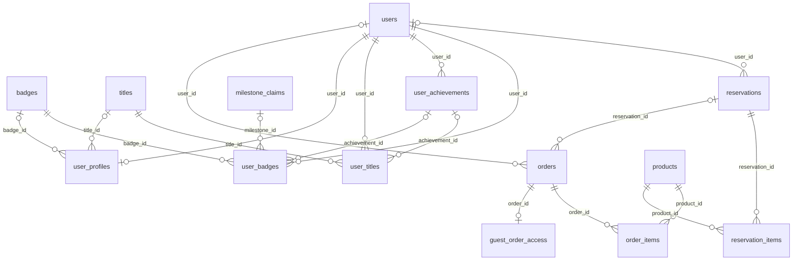

# 현재 DB 구조

코드 기준 갱신일: **2026-11-10 (KST)**. 기준 코드는 [server/db.py](../server/db.py)의 `SCHEMA`, 데이터 처리 코드는 [server/app.py](../server/app.py), 상품 규칙은 [server/catalog.py](../server/catalog.py)입니다.

현재 로컬 코드의 애플리케이션 테이블은 **29개**, 컬럼은 **192개**, 실제 외래키는 **48개**, CHECK 제약은 **49개**, 명시적 인덱스는 **5개**입니다. SQLite 내부 테이블·자동 인덱스는 제외합니다. 전화번호 계정 이전의 구 DB만 명시적 재생성이 필요합니다. 전화번호 계정 DB에는 비회원 주문 구조·임의 지급 테이블을 기존 기록을 유지하며 자동 추가합니다.

## 1. 실행 환경과 저장 위치

| 환경 | 현재 엔진 | DB 위치 |
| --- | --- | --- |
| 로컬 미리보기, 포트 8011 | SQLite, WAL 모드 | 레포의 `data/shared-inventory-preview.sqlite3` |
| 공개 가안, Oracle API | SQLite, WAL 모드 | `/var/lib/bbang-palja/prototype.sqlite3` |
| 환경 변수 없이 기본 실행 | SQLite | 레포의 `data/kambodelight.db` |

로컬과 공개 DB는 **서로 다른 데이터**를 저장합니다. 소스 push나 프론트 배포로 로컬 계정·주문·예약이 공개 DB에 복사되지는 않습니다. Cloudflare Pages는 프론트 파일을 제공하고, DB 접근은 Oracle에서 실행되는 Python API가 담당합니다.

`DATABASE_URL`에 `postgres://` 또는 `postgresql://` 주소가 있으면 psycopg 기반 PostgreSQL 어댑터를 사용합니다. 현재 공개 서버에는 이 연결을 사용하지 않습니다. PostgreSQL 초기화 시 자동 증가 ID 선언은 `BIGSERIAL PRIMARY KEY`로 바꾸지만, 나머지 기본 스키마는 같은 `SCHEMA`를 사용합니다. 날짜와 JSON 저장 컬럼도 현재 코드에서는 `TEXT`입니다. 현재 자동 배포의 DB 백업은 SQLite용이며 PostgreSQL 전환은 별도 배포 작업입니다.

## 2. 테이블 전체 목록

| 영역 | 테이블 | 저장하는 것 |
| --- | --- | --- |
| 계정 | `users` | 구매자·담당자 계정, 점수, 남은 주사위, 보상 수령 횟수 |
| 프로필 | `user_profiles` | 계정별 외모·착용 배지·착용 칭호, 저장 시각 |
| 배지 종류 | `badges` | 이름·그림·획득 안내·자동/수동 조건 |
| 배지 보유 | `user_badges` | 계정별 획득 배지·시각·획득 경로·담당자 |
| 칭호 종류 | `titles` | 이름·스타일·획득 안내·점수/도전과제/수동 조건 |
| 칭호 보유 | `user_titles` | 계정별 획득 칭호·시각·원본 보상·담당자 |
| 도전과제 | `user_achievements` | 구매 조건별 달성·날짜별 선착순 독점 기록 |
| 인증 | `sessions` | 로그인 토큰의 해시와 만료 시각 |
| 상품·재고 | `products` | 빵·우유 정보와 현판·예판 재고 |
| 재고 이력 | `inventory_logs` | 품목별 재고 증감, 사유, 처리자 이름 |
| 예판 | `reservations` | 예약자 이름·전화번호, 수령 상태, 연결 계정·주문 |
| 예판 항목 | `reservation_items` | 예약한 상품·수량·예약 당시 가격 |
| 예판 인증 | `preorder_verifications` | 구매자가 이름·전화번호를 확인한 예약의 조회 유효기간 |
| 주문 | `orders` | 회원·비회원 현장 구매·예판 수령·수기 판매 주문과 승인 상태 |
| 비회원 조회 | `guest_order_access` | 주문별 조회 키 해시와 중복 접수 방지 정보 |
| 임의 지급 | `manual_event_grants` | 계정·비회원에게 준 빵·상품·점수, 담당자와 사유 |
| 주문 항목 | `order_items` | 주문 당시 상품명·가격·수량 |
| 이전 주사위 | `dice_rolls` | 개편 전 1~6 결과 보존 |
| 주사위 지갑 | `dice_wallet` | 사용자·종류별 남은 수량 |
| 종류별 굴림 | `typed_dice_rolls` | 사용한 주사위 종류·점수/우유 결과 |
| 점수 보상 | `milestone_claims` | 5·10·15·20·30점의 1회 보상 |
| 이벤트 물품 | `event_supplies` | 오트밀 미니바이트 재고 |
| 이벤트 지급 | `reward_requests` | 당첨 물품 선택·재고 확보·담당자 승인/취소 |
| 빵 보상 | `rewards` | 당첨 상품과 보상 기준 점수 |
| 인스타 인증 | `events` | 사용자별 인증 및 우유·주사위 지급 내역 |
| 운영 메모 | `memos` | 인수인계 내용과 작성자 이름 |
| 담당 시간표 | `schedule` | 담당 팀·시간·역할 표시용 정보 |
| 내부 설정 | `settings` | 초기 데이터 준비 여부, 이전 우유 재고 호환 값 |
| 중복 요청 방지 | `idempotency` | 같은 요청의 중복 실행을 막기 위한 요청 식별자·응답 |

## 3. 핵심 관계

아래는 주문·예약·상품의 실제 외래키 관계입니다. `o|` 쪽은 연결이 없어도 되는 관계이고, `o{` 쪽은 여러 행이 연결될 수 있음을 뜻합니다.

`reservations.order_id`는 현재 접수·완료 주문을 가리키는 **코드상의 연결**이며, DDL에 `REFERENCES orders(id)`가 선언되어 있지는 않습니다. 반대편 `orders.reservation_id`는 실제 외래키입니다.

예약을 접수했다가 취소하고 다시 접수하면 한 예약에 여러 과거 주문이 남을 수 있습니다. 현재 활성 주문은 `reservations.order_id`로 관리합니다. `orders.reservation_id`에 UNIQUE 제약은 없으며 활성 주문 중복 방지는 애플리케이션의 쓰기 잠금과 상태 검사로 처리합니다.

## 4. 컬럼 상세

표의 `NN`은 DDL의 `NOT NULL`, `PK`는 기본키, `FK`는 실제 외래키, `NULL 허용`은 선택 컬럼입니다. `기본값 —`에 해당하는 컬럼은 앱이 값을 넣습니다. 일반적인 `id`는 자동 증가 정수이며 `products.id`만 카탈로그에서 고정 번호를 지정합니다.

시각은 UTC ISO 8601 문자열로 저장합니다. 앱의 기록 시각은 밀리초 정밀도이며 화면에서는 브라우저의 현지 시간대로 표시합니다. 금액은 원 단위 정수, 수량은 상품의 판매 단위입니다.

### 4.1 `users` — 계정과 게임 집계

| 컬럼 | 타입 | 제약·기본값 | 의미 |
| --- | --- | --- | --- |
| `id` | INTEGER | PK, 자동 증가 | 사용자 번호 |
| `name` | TEXT | NN | 화면에 보이는 닉네임 (구매자는 중복 허용) |
| `phone` | TEXT | UNIQUE, 구매자 필수·담당자 NULL | 010-NNNN-NNNN 계정 식별자 |
| `role` | TEXT | NN, `buyer` / `staff` | 구매자 또는 담당자 |
| `password_hash` | TEXT | NN | 구매자 PIN 해시. 담당자 행은 빈 문자열 |
| `score` | INTEGER | NN, 기본 0, 0 이상 | 누적 주사위 점수 |
| `dice_balance` | INTEGER | NN, 기본 0, 0 이상 | 아직 사용하지 않은 주사위 |
| `rewards_claimed` | INTEGER | NN, 기본 0, 0 이상 | 성공적으로 받은 점수 보상 횟수 (이전 빵 보상 포함) |
| `created_at` | TEXT | NN | 계정 생성 시각 |

- 구매자 식별자는 UNIQUE phone입니다. 닉네임은 중복 가능하며 담당자 이름만 부분 UNIQUE 인덱스 idx_staff_name으로 제한합니다. CHECK로 구매자 전화번호 필수·담당자 NULL과 정해진 ASCII 숫자/대시 형식을 검사합니다.
- 구매자 PIN은 숫자 네 자리이며 PBKDF2-HMAC-SHA256, 임의 salt, 160,000회 반복으로 저장합니다.
- 담당자 공용 비밀번호는 이 테이블에 저장하지 않고 `STAFF_PASSWORD` 환경 변수로 확인합니다.
- 가입·로그인은 전화번호를 정규화하고 공개 사용자 정보/순위/프로필에는 번호를 넣지 않습니다. 담당자 구매자 목록과 인증한 본인의 예약 조회 기본값(`pickup_defaults`)에 번호를 제공합니다. 예약 조회는 이름·전화번호를 수정해 다른 예약을 찾을 수 있으며 계정 정보는 수정하지 않습니다.
- 캐릭터 레벨은 별도 컬럼 없이 `min(5, rewards_claimed)`로 계산합니다.

### 4.2 `sessions` — 로그인 세션

| 컬럼 | 타입 | 제약·기본값 | 의미 |
| --- | --- | --- | --- |
| `token_hash` | TEXT | PK | 발급 토큰의 SHA-256 해시 |
| `user_id` | INTEGER | NN, FK → `users.id` | 로그인한 계정 |
| `expires_at` | TEXT | NN | 만료 시각 |

세션은 발급 시점부터 7일간 유효합니다. 새 로그인 시 만료된 세션을 삭제하고, 로그아웃 시 해당 토큰의 행을 삭제합니다. 원본 토큰은 발급 응답으로 전달하며 DB에는 해시를 저장합니다.

### 4.3 `products` — 품목과 재고

| 컬럼 | 타입 | 제약·기본값 | 의미 |
| --- | --- | --- | --- |
| `id` | INTEGER | PK, 고정 번호 | 상품 번호 |
| `name` | TEXT | NN | 실제 메뉴 이름 |
| `subtitle` | TEXT | NN | 연금술 컨셉 이름 |
| `price` | INTEGER | NN, 0 이상 | 현재 판매 단가 |
| `stock` | INTEGER | NN, 0 이상 | 현재 현판 판매·이벤트 지급에 쓸 수 있는 재고 |
| `preorder_stock` | INTEGER | NN, 기본 0, 0 이상 | 아직 수령 요청으로 확보하지 않은 예판 대기 재고 |
| `reward_stock` | INTEGER | NN, 기본 0, 0 이상 | 이전 별도 이벤트 재고 컬럼. 현재는 0으로 통합 종료 |
| `category` | TEXT | NN | 휘낭시에·타르트·음료 등 분류 |
| `image` | TEXT | NN | 컨셉 SVG 이미지 식별자 |

현재 판매 목록은 카탈로그의 101~113번입니다. 우유는 112번, 두유는 113번이며 각각 1,000원입니다. 이전 메뉴 번호가 DB에 남아 있어도 현재 판매 목록에서 제외할 수 있고, 과거 주문·예약의 참조는 보존합니다.

도넛 108번은 5개 한 세트가 재고 1단위입니다. 판매 단위 `unit`, 실물 사진 경로 `photo`, 주사위 지급 단위 `dice_per_unit`, 추첨 대상 여부 `reward_eligible`은 API에서 카탈로그를 기준으로 붙이는 값이며 DB 컬럼이 아닙니다. 실물 사진 파일은 `frontend/assets/photos/`, 매핑은 `PRODUCT_PHOTOS`에서 관리합니다.

### 4.4 `reservations` — 예판 예약과 수령 연결

| 컬럼 | 타입 | 제약·기본값 | 의미 |
| --- | --- | --- | --- |
| `id` | INTEGER | PK, 자동 증가 | 예약 번호 |
| `name` | TEXT | NN | 원래 예약자 이름 |
| `phone` | TEXT | NN | 010-NNNN-NNNN 예약 전화번호 |
| `status` | TEXT | NN, 기본 `reserved` | `reserved` / `pending` / `approved` |
| `user_id` | INTEGER | NULL 허용, FK → `users.id` | 예약을 수령하는 구매자 계정 |
| `order_id` | INTEGER | NULL 허용, 코드상 → `orders.id` | 현재 수령 주문. DB 외래키 선언 없음 |
| `created_at` | TEXT | NN | 예약 등록 시각 |

`UNIQUE(name, phone)`으로 같은 이름·전화번호의 예약을 중복 등록하지 않습니다. 전화번호는 정수형이 아니므로 앞의 0을 보존합니다.

| 상태 | 의미 | 연결 계정·주문 |
| --- | --- | --- |
| `reserved` | 예약 등록 후 수령 대기 | 정상 앱 흐름에서는 두 연결 값 모두 NULL |
| `pending` | 구매자가 수령 요청, 담당자 승인 대기 | 계정·대기 주문 연결 |
| `approved` | 담당자가 수령 승인 | 계정·승인 주문 연결 |

담당자는 미접수 예약을 이름이 다른 기존 계정에도 연결할 수 있습니다. 원래 예약자 이름·전화번호는 유지하고 주문·주사위는 선택한 계정에 추가합니다. 접수·완료된 예약은 연결 계정을 바꾸지 않습니다. 상태별 연결 값의 조합은 CHECK 제약이 아니라 앱이 관리합니다.

### 4.5 `reservation_items` — 예약 품목

| 컬럼 | 타입 | 제약·기본값 | 의미 |
| --- | --- | --- | --- |
| `id` | INTEGER | PK, 자동 증가 | 예약 항목 번호 |
| `reservation_id` | INTEGER | NN, FK → `reservations.id` | 소속 예약 |
| `product_id` | INTEGER | NN, FK → `products.id` | 예약 품목 |
| `quantity` | INTEGER | NN, 1 이상 | 예약 수량 |
| `price` | INTEGER | NN, 0 이상 | 예약 당시 단가 |

예약 가격은 이 테이블의 스냅샷을 사용하므로 현재 상품 가격이 달라져도 유지합니다. 상품명 스냅샷 컬럼은 없어서 예약 조회 시 `products.name`을 JOIN합니다. 예약 합계는 `SUM(quantity × price)`로 계산하며 `reservations`에는 합계 컬럼이 없습니다.

### 4.6 `preorder_verifications` — 구매자 예약 조회 확인

| 컬럼 | 타입 | 제약·기본값 | 의미 |
| --- | --- | --- | --- |
| `user_id` | INTEGER | NN, 복합 PK, FK → `users.id` | 조회한 구매자 |
| `reservation_id` | INTEGER | NN, 복합 PK, FK → `reservations.id` | 확인한 예약 |
| `expires_at` | TEXT | NN | 확인 유효기간 |

복합 기본키는 `(user_id, reservation_id)`입니다. 구매자가 입력한 예약자 이름·전화번호로 예약을 조회하면 해당 계정에 24시간 유효한 확인을 기록합니다. 가입 정보와 다른 조회값도 허용합니다. 수령 요청은 이 확인을 검사하며, 이미 다른 계정에 연결된 예약은 가져올 수 없습니다. 담당자의 조회는 이 확인 기록을 만들지 않습니다.

### 4.7 `orders` — 구매와 수령 주문

| 컬럼 | 타입 | 제약·기본값 | 의미 |
| --- | --- | --- | --- |
| `id` | INTEGER | PK, 자동 증가 | 주문 번호 |
| `user_id` | INTEGER | NULL 허용, FK → `users.id` | 연결 계정. 비회원 주문은 NULL |
| `customer_name` | TEXT | NN | 주문 당시 계정 닉네임 또는 비회원이 입력한 이름 |
| `type` | TEXT | NN | `walkin` / `preorder` / `manual` |
| `status` | TEXT | NN | `pending` / `approved` / `cancelled` |
| `reservation_id` | INTEGER | NULL 허용, FK → `reservations.id` | 예판 수령의 원래 예약 |
| `total` | INTEGER | NN, 0 이상 | 생성 당시 총 금액, 우유 포함 |
| `quantity` | INTEGER | NN, 1 이상 | 생성 당시 총 판매 단위 수, 우유 포함 |
| `created_at` | TEXT | NN | 접수 시각 |
| `approved_at` | TEXT | NULL 허용 | 승인 시각 |
| `cancelled_at` | TEXT | NULL 허용 | 취소 시각 |

유형은 `walkin`=구매자 현장 구매, `preorder`=예판 수령, `manual`=담당자 수기 현장 판매입니다. **수기 예판 수령도 유형은 `preorder`**입니다.

기본 전환은 `pending → approved` 또는 `pending → cancelled`입니다. 수기 판매·수기 예판 수령은 승인된 상태로 즉시 생성할 수 있습니다. 승인 후 취소와 취소 후 승인은 현재 API에서 거부합니다. 이 전환 규칙과 시각 컬럼의 일관성은 앱이 관리하며 DB CHECK는 상태 값의 종류만 제한합니다.

`dice_quantity`는 DB 컬럼이 아니며 비회원 주문은 0입니다. 계정에 연결된 현판·수기 현장은 음료 제외 수량 합, 예판은 빵 포함 시 1개입니다. 예판을 다른 이름의 기존 계정에 연결하면 `customer_name`과 `reservations.name`은 다를 수 있습니다.

### 4.8 `order_items` — 주문 품목 스냅샷

| 컬럼 | 타입 | 제약·기본값 | 의미 |
| --- | --- | --- | --- |
| `id` | INTEGER | PK, 자동 증가 | 주문 항목 번호 |
| `order_id` | INTEGER | NN, FK → `orders.id` | 소속 주문 |
| `product_id` | INTEGER | NN, FK → `products.id` | 원래 상품 |
| `name` | TEXT | NN | 주문 당시 상품 이름 |
| `quantity` | INTEGER | NN, 1 이상 | 주문 수량 |
| `price` | INTEGER | NN, 0 이상 | 주문 당시 단가 |

상품명·가격이 나중에 바뀌어도 과거 주문 내역을 유지합니다. `orders.total`·`quantity`와 항목 합계가 맞는지는 주문 생성 코드에서 보장하며 별도 트리거는 없습니다.

### 4.9 `inventory_logs` — 재고 증감 이력

| 컬럼 | 타입 | 제약·기본값 | 의미 |
| --- | --- | --- | --- |
| `id` | INTEGER | PK, 자동 증가 | 변경 기록 번호 |
| `product_id` | INTEGER | NULL 허용, FK → `products.id` | 변경 상품. 이전 우유 이력 등은 NULL 가능 |
| `product_name` | TEXT | NN | 변경 당시 품목명 |
| `bucket` | TEXT | NN | 변경 재고 구분 |
| `delta` | INTEGER | NN | 증감량. 양수 입고·반환, 음수 확보·지급 |
| `reason` | TEXT | NN | 주문·예약·보상·수정 등의 사유 |
| `actor` | TEXT | NN | 처리자 이름 또는 시스템 표시 |
| `created_at` | TEXT | NN | 변경 시각 |

현재 앱은 `stock`, `preorder_stock`을 수정합니다. 과거 `reward_stock`, `milk` 이력도 보존합니다. `actor`는 사용자 ID 외래키가 아닌 문자열입니다. DB에는 `bucket` ENUM이나 `delta != 0` CHECK가 없고 앱이 허용 구분·수량·잔량을 검사합니다.

### 4.10 `dice_rolls` — 주사위 이력

| 컬럼 | 타입 | 제약·기본값 | 의미 |
| --- | --- | --- | --- |
| `id` | INTEGER | PK, 자동 증가 | 굴림 번호 |
| `user_id` | INTEGER | NN, FK → `users.id` | 굴린 구매자 |
| `value` | INTEGER | NN, 1~6 | 서버가 정한 눈금 |
| `created_at` | TEXT | NN | 굴린 시각 |

개편 전 기록을 그대로 보존합니다. 새 굴림은 0점 우유와 22점까지 지원하는 `typed_dice_rolls`에만 기록합니다.

### 4.11 `rewards` — 랜덤 빵 당첨 기록

| 컬럼 | 타입 | 제약·기본값 | 의미 |
| --- | --- | --- | --- |
| `id` | INTEGER | PK, 자동 증가 | 당첨 번호 |
| `user_id` | INTEGER | NN, FK → `users.id` | 보상 계정 |
| `product_id` | INTEGER | NN, FK → `products.id` | 당첨 상품 |
| `product_name` | TEXT | NN | 당첨 당시 상품명 |
| `threshold` | INTEGER | NN, 1 이상 | 보상을 받은 기준 점수 |
| `created_at` | TEXT | NN | 당첨 확정 시각 |

개편 전 당첨 기록입니다. 조회 시 `kind=legacy_bread`로 구분합니다. 새 보상은 `milestone_claims`를 사용하며 과거 수령 횟수로 새 기준을 계산하지 않습니다.

DB에 `UNIQUE(user_id, threshold)`는 없고 쓰기 잠금·보상 횟수·요청 재시도 검사로 중복 지급을 막습니다. 이전 기록은 전달 상태가 없고 새 물품 지급은 `reward_requests`에서 상태와 처리 시각을 관리합니다.

### 4.12 `events` — 인스타 인증과 지급 이력

| 컬럼 | 타입 | 제약·기본값 | 의미 |
| --- | --- | --- | --- |
| `id` | INTEGER | PK, 자동 증가 | 인증 번호 |
| `user_id` | INTEGER | NN, FK → `users.id` | 인증 대상 구매자 |
| `customer_name` | TEXT | NN | 인증 당시 계정 이름 |
| `type` | TEXT | NN | 이벤트 종류. 현재 앱은 `instagram` 사용 |
| `milk_quantity` | INTEGER | NN, 0 이상 | 지급한 우유 수량 |
| `dice` | INTEGER | NN, 0 이상 | 추가 지급한 주사위 수 |
| `created_at` | TEXT | NN | 인증 시각 |

`UNIQUE(user_id, type)`으로 계정당 같은 이벤트를 한 번만 인증합니다. 새 인증은 `milk_quantity=0,dice=1`로 고정하며 `dice_wallet.instagram`에 1개를 추가합니다. 인증 시 우유 재고는 바꾸지 않습니다. 과거 선택 지급 기록은 유지합니다. `type` 자체는 DB CHECK로 제한하지 않습니다.

### 4.13 `memos` — 인수인계

| 컬럼 | 타입 | 제약·기본값 | 의미 |
| --- | --- | --- | --- |
| `id` | INTEGER | PK, 자동 증가 | 메모 번호 |
| `content` | TEXT | NN | 인수인계 내용 |
| `author` | TEXT | NN | 작성자 이름 문자열, 사용자 FK 아님 |
| `created_at` | TEXT | NN | 작성 시각 |

### 4.14 `schedule` — 담당 시간표

| 컬럼 | 타입 | 제약·기본값 | 의미 |
| --- | --- | --- | --- |
| `id` | INTEGER | PK, 자동 증가 | 시간표 항목 번호 |
| `name` | TEXT | NN | 담당 팀·이름 표시 |
| `time` | TEXT | NN | 시간대 표시 문자열 |
| `role` | TEXT | NN | 업무·역할 표시 문자열 |
| `event_date` | TEXT | NULL 허용 | 행사 날짜 YYYY-MM-DD. 기존 공통 시간표는 NULL |

`time`은 오픈 또는 HH:MM-HH:MM 표시 문자열이고 `role`은 `users.role`과 별개입니다. 사용자 계정 외래키는 없습니다. 날짜별 열과 시간대별 행은 관리자 화면에서 DB 데이터로 만듭니다. 기존 테이블에는 event_date만 자동 추가하며 명단은 바꾸지 않습니다. 실제 이름·배정은 운영 DB에만 등록하고 레포에는 넣지 않습니다.

서버에서 `server.schedule.replace_dates(tx, rows)`를 쓰기 트랜잭션 안에서 호출합니다. 행 형식은 `{event_date,time,name,role?}`이며 이름은 쉼표로 묶을 수 있습니다. 날짜·시간·중복 슬롯을 모두 검증한 뒤 입력에 포함된 날짜만 교체합니다. 다른 날짜·공통 시간표·계정·주문·재고는 보존합니다.

### 4.15 `settings` — 내부 설정

| 컬럼 | 타입 | 제약·기본값 | 의미 |
| --- | --- | --- | --- |
| `key` | TEXT | PK | 설정 이름 |
| `value` | TEXT | NN | 문자열 값 |

현재 앱이 쓰는 키는 다음과 같습니다.

| 키 | 의미 |
| --- | --- |
| `demo_seeded` | 데모 계정·주문 등을 중복 생성하지 않기 위한 표시 |
| `milk_stock` | 이전 별도 우유 재고 호환 값. 남은 양을 상품 112번에 이전한 뒤 `0`으로 닫음 |

우유의 현재 수량은 `settings.milk_stock`이 아니라 `products.stock`을 읽습니다. 보상 단계는 `server/game.py`의 `MILESTONES`이며 `settings.typed_dice_v1`은 기존 잔여 주사위를 지갑으로 한 번만 이관한 표시입니다. PIN·담당자 공용 비밀번호·API 접속 주소를 이 테이블에서 관리하지 않습니다.

### 4.16 `idempotency` — 요청 재시도 기록

| 컬럼 | 타입 | 제약·기본값 | 의미 |
| --- | --- | --- | --- |
| `user_id` | INTEGER | NN, 복합 PK, FK → `users.id` | 요청한 계정 |
| `scope` | TEXT | NN, 복합 PK | 주문·주사위·보상 등 작업 구분 |
| `request_id` | TEXT | NN, 복합 PK | 클라이언트가 만든 요청 식별자 |
| `fingerprint` | TEXT | NN | 키를 정렬해 직렬화한 요청 JSON의 SHA-256 해시 |
| `response` | TEXT | NN | 성공 결과 JSON 문자열 |
| `created_at` | TEXT | NN | 결과 저장 시각 |

복합 기본키는 `(user_id, scope, request_id)`입니다. 같은 키와 같은 내용이면 저장한 응답을 반환하고, 같은 키에 다른 내용이면 409로 거부합니다. 실제 변경과 이 기록을 같은 트랜잭션으로 저장하므로 실패한 작업이 성공 결과로 남지 않습니다.

현재 scope에는 `order`, `manual-sale`, `manual-preorder`, `preorder:<예약번호>`, `roll`, `reward`, `instagram`, `inventory`가 있습니다. 재고 수정의 요청 ID는 API에서 선택 사항입니다. 승인·취소는 이 테이블 대신 주문 상태 검사로 반복 실행을 막고, 예판 등록은 이름·전화번호 UNIQUE 제약으로 중복을 거부합니다.

### 4.17 `user_profiles` — 캐릭터 프로필

| 컬럼 | 타입 | 제약·기본값 | 의미 |
| --- | --- | --- | --- |
| `user_id` | INTEGER | NN, PK, FK → `users.id` | 프로필 소유 계정 |
| `appearance` | TEXT | NN | `face_shape`, `skin`, `expression`, `glasses`, `hairpin`의 JSON 객체 |
| `badge_id` | TEXT | NULL 허용, FK → `badges.id` | 착용 배지 하나. 미착용은 NULL |
| `title_id` | TEXT | NULL 허용, FK → `titles.id` | 착용 칭호 하나. 미착용은 NULL |
| `updated_at` | TEXT | NN | 마지막 저장 시각 |

저장한 프로필이 없는 기존 계정에는 ID를 기준으로 만든 기본 외모를 응답하며 읽기만으로 행을 만들지 않습니다. 로그인한 계정 자신의 프로필만 수정할 수 있고 허용한 선택값만 저장합니다. 계정당 한 행을 UPSERT하므로 반복 저장해도 행을 추가하지 않습니다. 저장은 기존 쓰기 잠금 안에서 처리하며 점수·주사위·보상 횟수는 변경하지 않습니다. 실제 사진 파일이나 외부 이미지 URL은 저장하지 않습니다.

머리핀 소유권은 별도 테이블에 저장하지 않고 승인된 `orders`와 `order_items`의 상품 종류로 계산합니다. 현판·예판·수기 판매를 포함하고 우유는 제외합니다. 저장 및 응답 시 소유권을 확인합니다. `unlocked_hairpins`는 본인 계정과 담당자 구매자 목록에만 제공하며 순위표에는 착용한 외모만 제공합니다. 선글라스 소유권은 `milestone_claims`의 15점 수령 기록 또는 `manual_event_grants`의 선글라스 임의 지급 기록으로 확인합니다. 미획득 착용 저장은 403, 응답에서는 미획득 선글라스를 제거합니다. 이전 6항목 JSON은 읽을 수 있고, 다시 저장하면 새 5항목 형식으로 저장합니다.

### 4.18 `dice_wallet` — 종류별 주사위 지갑

| 컬럼 | 타입 | 제약 | 의미 |
| --- | --- | --- | --- |
| `user_id` | INTEGER | NN, 복합 PK, FK → users | 소유자 |
| `kind` | TEXT | NN, 복합 PK | walkin / preorder_plain·rainbow·silver·gold / instagram |
| `quantity` | INTEGER | NN, 0 이상 | 남은 개수 |

지급·사용 시 `users.dice_balance`와 함께 갱신합니다. 기존 잔여 주사위는 최초 실행에 `walkin`으로 한 번만 이관합니다. 면 구성은 DB나 프론트가 아니라 `server/game.py`에 있습니다.

### 4.19 `typed_dice_rolls` — 종류별 결과

| 컬럼 | 타입 | 제약 | 의미 |
| --- | --- | --- | --- |
| `id` | INTEGER | PK, 자동 증가 | 굴림 번호 |
| `user_id` | INTEGER | NN, FK → users | 사용자 |
| `kind` | TEXT | NN | 사용한 주사위 종류 |
| `result` | TEXT | NN, score / milk | 점수 또는 우유 |
| `value` | INTEGER | NN, 0~22 | 추가 점수. 우유 면은 0 |
| `created_at` | TEXT | NN | 확정 시각 |

주사위 차감·점수/우유 재고 변경·결과·재시도 기록은 하나의 쓰기 트랜잭션입니다. 우유 면은 주사위를 소비하고 `awaiting_choice` 지급 요청을 생성합니다. 실제 음료는 구매자가 선택할 때 재고를 확보합니다. 품절 선택은 거절하며 이미 확정된 결과를 다시 뽑지 않습니다.

### 4.20 `milestone_claims` — 점수별 1회 보상

| 컬럼 | 타입 | 제약 | 의미 |
| --- | --- | --- | --- |
| `id` | INTEGER | PK, 자동 증가 | 보상 번호 |
| `user_id` | INTEGER | NN, FK → users | 사용자 |
| `threshold` | INTEGER | NN, 5/10/15/20/30 | 달성 기준 |
| `kind` | TEXT | NN | oatmeal / milk / sunglasses / bread |
| `product_id` | INTEGER | NULL 허용, FK → products | 우유·빵 품목. 오트밀·선글라스는 NULL |
| `product_name` | TEXT | NN | 보상명 |
| `created_at` | TEXT | NN | 수령 확정 시각 |

`UNIQUE(user_id,threshold)`로 중복 지급을 막습니다. 선택한 기준 점수의 달성 여부·미수령 여부를 확인하여 순서와 무관하게 한 번씩 지급하며 30점에서 끝납니다. API에서 기준 점수를 생략하면 미수령 최저 기준을 사용합니다. 5·10점 보상은 배지도 함께 저장·지급합니다. 15·30점 보상은 칭호도 함께 저장·지급합니다. 빵만 현판 `stock²` 가중치로 추첨하며 우유 보상은 112번 우유·113번 두유를 선택하고, 오트밀은 `event_supplies`를 사용합니다. 물리적 지급은 `reward_requests`에 연결합니다. 지급 취소가 확정된 점수 단계·캐릭터 레벨을 되돌리지는 않습니다.

### 4.21 `event_supplies` — 판매하지 않는 이벤트 재고

| 컬럼 | 타입 | 제약 | 의미 |
| --- | --- | --- | --- |
| `key` | TEXT | PK | 현재 oatmeal |
| `name` | TEXT | NN | 오트밀 미니바이트 |
| `stock` | INTEGER | NN, 0 이상 | 남은 개수 |

운영 기본 0, 데모 최초 40개입니다. 관리자 재고 수정·5점 보상에 따라 변경하고 `inventory_logs.bucket=event_supply`로 이력을 남깁니다. 판매 메뉴·랜덤 빵 추첨에는 넣지 않습니다.

### 4.22 `reward_requests` — 이벤트 물품 지급

| 컬럼 | 타입 | 제약 | 의미 |
| --- | --- | --- | --- |
| `id` | INTEGER | PK, 자동 증가 | 지급 요청 번호 |
| `user_id` | INTEGER | NN, FK → users | 구매자 |
| `milestone_id` | INTEGER | NULL 허용, UNIQUE, FK → milestone_claims | 점수 보상 원본 |
| `roll_id` | INTEGER | NULL 허용, UNIQUE, FK → typed_dice_rolls | 주사위 보상 원본 |
| `kind` | TEXT | NN, bread/milk/oatmeal | 물품 구분 |
| `status` | TEXT | NN, awaiting_choice/pending/approved/cancelled | 선택 중/확보·대기/전달 완료/취소 |
| `product_id` | INTEGER | NULL 허용, FK → products | 확보한 빵·우유·두유 |
| `supply_key` | TEXT | NULL 허용, FK → event_supplies | 오트밀 재고 키 |
| `product_name` | TEXT | NN | 물품명 스냅샷 |
| `created_at` | TEXT | NN | 당첨·요청 생성 |
| `requested_at` | TEXT | NULL 허용 | 재고 확보 시각 |
| `processed_at` | TEXT | NULL 허용 | 승인/취소 시각 |
| `processed_by` | TEXT | NULL 허용 | 처리 담당자/미수령 선택자 |

CHECK로 두 원본 중 정확히 하나만 연결하고 각 원본의 UNIQUE로 중복 요청을 막습니다. 빵·오트밀은 생성 시 재고를 확보하여 pending, 음료는 awaiting_choice에서 구매자의 재고 있는 품목 선택 후 pending이 됩니다. 승인 시 재차 차감하지 않고, pending 취소 시 1개 반환합니다. 선택 전 취소는 재고 변화가 없습니다. 동일 처리는 반복 가능하며 승인↔취소 전환은 거부합니다. 취소 후 재추첨·주사위 환급·점수 단계 재사용은 없습니다. 디지털 보상은 이 테이블을 만들지 않습니다. 과거 보상도 소급하여 대기로 생성하지 않습니다.

### 4.23 `guest_order_access` — 비회원 주문 조회

| 컬럼 | 타입 | 제약 | 의미 |
| --- | --- | --- | --- |
| `token_hash` | TEXT | PK | 브라우저에서 생성한 임의 요청 키의 SHA-256 해시 |
| `order_id` | INTEGER | NN, UNIQUE, FK → `orders.id` | 구매 사건별 자동 증가 주문 번호 |
| `fingerprint` | TEXT | NN | 요청 내용 해시. 같은 키로 다른 주문 제출 시 거부 |
| `created_at` | TEXT | NN | 접수 시각 |

비회원 계정·세션은 만들지 않습니다. 이름은 `orders.customer_name`에만 저장하며 회원과 같은 주문 번호·재고·승인/취소 흐름을 씁니다. 조회 키는 브라우저에 저장하고 Authorization 헤더로 전송합니다. 주문 번호만 알아서는 조회할 수 없습니다. 수기 판매·예약 수령은 담당자 화면에서만 처리하므로 이 조회 행을 생성하지 않습니다.

전화번호 계정 DB에 적용할 때는 `orders.user_id`를 NULL 허용으로 자동 변경합니다. 기존 주문·품목·계정·세션·주문 번호 증가 값은 유지하며 재초기화하지 않습니다. SQLite는 잠금과 트랜잭션 안에서 테이블을 교체하고 외래키 검사 후 반영합니다.

### 4.24 `manual_event_grants` — 담당자 임의 지급

| 컬럼 | 타입 | 제약 | 의미 |
| --- | --- | --- | --- |
| `id` | INTEGER | PK, 자동 증가 | 임의 지급 번호 |
| `user_id` | INTEGER | NULL 허용, FK → `users.id` | 받는 계정. 비회원은 NULL |
| `customer_name` | TEXT | NN | 당시 닉네임 또는 비회원 이름 |
| `kind` | TEXT | NN, bread/gift/score | 빵·상품·점수 |
| `product_id` | INTEGER | NULL 허용, FK → `products.id` | 지급 빵·우유·두유 |
| `supply_key` | TEXT | NULL 허용, FK → `event_supplies.key` | 오트밀 재고 |
| `gift_key` | TEXT | NULL 허용 | oatmeal/milk/soymilk/sunglasses/custom |
| `item_name` | TEXT | NN | 지급 당시 물품명 또는 점수 |
| `quantity` | INTEGER | NN, 양수 | 지급 수량. 점수·선글라스는 1 |
| `points` | INTEGER | NN, 기본 0, 0 이상 | 점수 지급량. 물품 지급은 0 |
| `reason` | TEXT | NN | 담당자가 입력한 지급 사유 |
| `staff_id` | INTEGER | NN, FK → `users.id` | 지급 담당자 |
| `staff_name` | TEXT | NN | 당시 담당자 이름 |
| `created_at` | TEXT | NN | 지급 기록 시각 |

빵·음료는 현판 재고, 오트밀은 해당 물품 재고를 같은 쓰기 트랜잭션에서 차감합니다. 기타 상품은 이름과 수량만 기록합니다. 비회원 점수·프로필 선글라스 지급은 거부합니다. 점수는 `users.score`에 더하고 선글라스는 지급 기록 자체로 착용 권한을 확인합니다. 주사위·매출·구매 기록·점수 보상 수령 기록은 추가하지 않습니다.

담당자 인증, 대상·수량·사유 확인, 재고/점수 변경, 임의 지급 기록과 `idempotency` 기록을 함께 반영합니다. 기존 지급 대기 요청은 자동으로 승인·취소하지 않습니다. 이 테이블 추가에 DB 초기화는 필요하지 않습니다.

### 4.25 `badges` — 배지 종류와 획득 조건

| 컬럼 | 타입 | 제약 | 의미 |
| --- | --- | --- | --- |
| `id` | TEXT | PK | 기본 배지 고정 ID 또는 서버 생성 custom ID |
| `name` | TEXT | NN | 배지 이름 |
| `description` | TEXT | NN | 미획득 배지를 눌렀을 때 보이는 획득 안내 |
| `icon` | TEXT | NN, 고정 6종 | spark/flask/star/heart/bread/trophy |
| `rule` | TEXT | NN | milestone: 점수 보상, achievement: 구매 도전과제, manual: 담당자 확인 |
| `threshold` | INTEGER | 조건부 양수/NULL | 자동 배지의 보상 점수. 수동은 NULL |
| `created_at` | TEXT | NN | 등록 시각 |
| `created_by` | INTEGER | NULL 허용, FK → `users.id` | 수동 배지 등록 담당자. 기본 배지는 NULL |

기본 종류는 5점 보상의 **마법의 씨앗**, 10점 보상의 **빛나는 연금술**, 구매 도전과제 4종(원소 수집가·VVIP·빵 몰입가·번개)입니다. 추가 배지는 관리자에게서 이름·획득 안내·그림을 받아 등록하며 조건 충족을 확인한 담당자가 지급합니다.

### 4.26 `user_badges` — 계정별 보유 배지

| 컬럼 | 타입 | 제약 | 의미 |
| --- | --- | --- | --- |
| `id` | INTEGER | PK, 자동 증가 | 획득 기록 번호 |
| `user_id` | INTEGER | NN, FK → `users.id` | 보유 계정 |
| `badge_id` | TEXT | NN, FK → `badges.id` | 획득 배지 |
| `source` | TEXT | NN | milestone/manual/achievement |
| `milestone_id` | INTEGER | NULL 허용, FK → `milestone_claims.id` | 자동 지급의 원래 점수 보상 |
| `achievement_id` | INTEGER | NULL 허용, FK → `user_achievements.id` | 구매 도전과제 달성 원본 |
| `granted_by` | INTEGER | NULL 허용, FK → `users.id` | 수동 지급 담당자 |
| `reason` | TEXT | NN | 지급 사유 |
| `earned_at` | TEXT | NN | 최초 획득 시각 |

`UNIQUE(user_id,badge_id)`로 같은 배지의 중복 보유를 막습니다. source별로 milestone_id / achievement_id / granted_by 중 정확히 하나가 필요합니다. 보유 목록과 착용 선택은 분리하며, 프로필 저장 API는 본인이 보유한 배지만 허용합니다. 공개 순위에는 착용 배지의 ID·이름·그림만 제공하고 전체 보유 목록은 본인/담당자에게만 제공합니다.

새 구조는 배지 테이블과 `user_profiles.badge_id`를 자동 추가하고 기존 프로필·계정·세션·주문을 보존합니다. 기존 5·10점 정상 보상 기록은 원래 시각으로 소급 지급하며 자동 착용하지 않습니다. DB 초기화는 필요하지 않습니다.

### 4.27 `titles` — 칭호 정의

| 컬럼 | 타입 | 제약·의미 |
| --- | --- | --- |
| `id` | TEXT | PK. 기본 고정 ID 또는 서버 생성 custom ID |
| `name` / `description` | TEXT | NN. 칭호 이름·획득 안내 |
| `style` | TEXT | NN. magic / gold / lightning |
| `rule` | TEXT | NN. milestone / achievement / manual |
| `threshold` | INTEGER | milestone이면 양수, 나머지는 NULL |
| `created_at` | TEXT | NN. 등록 시각 |
| `created_by` | INTEGER | NULL 허용, FK → users. 수동 등록 담당자 |

기본 칭호는 15점 멋쟁이 마법사, 30점 대현자 연금술사, 원소 수집가, 캄딜 VVIP, ⚡ 우사인볼트 연금술사, 빵 11종의 메뉴명 몰입가(총 16종)입니다. 추가 칭호는 담당자가 이름·획득 방법·스타일을 정합니다.

### 4.28 `user_achievements` — 도전과제 달성 기록

| 컬럼 | 타입 | 제약·의미 |
| --- | --- | --- |
| `id` | INTEGER | PK, 자동 증가 |
| `user_id` | INTEGER | NN, FK → users |
| `achievement_key` | TEXT | NN. elements / all_breads / focus / preorder_fast / walkin_fast |
| `scope` | TEXT | NN, 기본 빈 문자열. focus는 품목 ID, walkin_fast는 KST 날짜 |
| `exclusive_key` | TEXT | NULL 허용, UNIQUE. 일별 현판/예약 전화번호별 선착순 독점 키 |
| `order_id` | INTEGER | NULL 허용, FK → orders. 선착순 근거 주문 |
| `reservation_id` | INTEGER | NULL 허용, FK → reservations. 예판 선착순 근거 |
| `earned_at` | TEXT | NN. 달성 시각 |

`UNIQUE(user_id,achievement_key,scope)`로 같은 달성을 반복 기록하지 않습니다. 승인된 예판·현판·수기 빵 판매만 합산하고 대기/취소·음료·무료 지급은 제외합니다. 주문 승인·취소와 같은 쓰기 잠금 안에서 달성과 배지·칭호를 함께 반영합니다. 현판은 같은 KST 날짜의 첫 유효 빵 주문만 인정하며, 앞 대기 주문이 있으면 지급을 기다립니다. 비회원 첫 주문도 선착순 자리를 차지합니다. 예판은 등록 순서의 전화번호가 다른 첫 10명이 수령 승인 시 인정됩니다.

### 4.29 `user_titles` — 계정별 보유 칭호

`id`(자동 증가 PK), `user_id`(users FK), `title_id`(titles FK), `source`, `milestone_id`(milestone_claims FK), `achievement_id`(user_achievements FK), `granted_by`(users FK), `reason`, `earned_at`를 저장합니다. `UNIQUE(user_id,title_id)`, source별 원본 하나만 허용하는 CHECK는 user_badges와 같습니다. 전체 보유 목록은 본인·담당자 전용이며 공개 순위에는 착용 칭호 ID·이름·스타일만 제공합니다.

첫 칭호는 자동 착용하고 VVIP는 우선 착용합니다. 사용자 저장은 보유 여부를 다시 확인하며 미보유 칭호는 403으로 전체 저장을 거부합니다. 반복 조회·재시작은 이미 선택/해제한 칭호를 바꾸지 않습니다.

## 5. DB에 저장하지 않고 계산하는 값

| 화면/API 값 | 계산 기준 |
| --- | --- |
| 캐릭터 `level` | `min(5, users.rewards_claimed)` |
| 다음 보상 점수 | 5·10·15·20·30 중 미수령 최저 기준 |
| 주문 `dice_quantity` | 비회원은 0. 회원 현판·수기 현장은 음료 제외 수량 합, 예판은 빵 포함 시 1개 |
| 예약 합계 | `reservation_items.quantity × price`의 합 |
| 접수 보관 수량 | 해당 품목의 `pending` 주문 항목 수량 합 + `pending` 이벤트 요청 수량 |
| 재고 표의 매장 예상 | `stock + preorder_stock + 접수 보관` |
| 관리자 주문 항목 `remaining_stock` | 조회 시점의 `stock` (예판 주문은 `preorder_stock`). 주문 접수 시 이미 차감되어 추가 차감하지 않음 |
| 순위 | 구매자만 `score DESC, id ASC`로 정렬. 동점이면 작은 사용자 번호 우선 |
| 매출 | `approved` 주문의 `total` 합계 |
| 판매 빵 수 | 승인된 주문 항목 중 우유·두유를 제외한 수량 합 |
| 현재 우유 수량 | 112번 상품의 `stock` |
| 관리자 예판 수령 현황 | `reservations`와 `reservation_items`·`products` 조회 |

외모는 `user_profiles`에 저장하고, 레벨·순위·일별 점수·결제 내역을 위한 별도 테이블은 없습니다. 양일 점수는 같은 `users.score`에 누적됩니다. 실제 결제사·이체 연동은 없고 담당자 승인 상태가 판매 인정 기준입니다.

## 6. 주요 작업이 바꾸는 데이터

`q`는 판매 단위 수, `b`는 그중 음료를 제외한 빵 수입니다.

| 작업 | 재고 | 주문·예약 | 계정·이력 |
| --- | --- | --- | --- |
| 예판 등록 | `stock -q`, `preorder_stock +q` | 예약·항목 생성, `reserved` | 재고 이동 이력 |
| 현장 구매 요청 | `stock -q` | `walkin/pending` 주문·항목 생성 | 재고 확보 이력 |
| 구매자 예판 수령 요청 | `preorder_stock -q` | `preorder/pending`, 예약을 `pending`으로 연결 | 24시간 조회 확인 검사, 재고 확보 이력 |
| 대기 주문 승인 | 추가 재고 차감 없음 | 주문 `approved`, 예판이면 예약도 `approved` | 현판 `+b` / 예판 전용 1개 |
| 대기 주문 취소 | 원래 차감한 재고 구분으로 `+q` 반환 | 주문 `cancelled`; 예판은 `reserved`로 복구하고 계정·현재 주문 연결 해제 | 재고 반환 이력 |
| 수기 현장 판매 | `stock -q` | `manual/approved` 즉시 생성 | 선택 계정 또는 생성 계정에 주사위 `+b` |
| 미접수 예판 수기 수령 | `preorder_stock -q` | `preorder/approved` 즉시 생성, 예약 연결·완료 | 선택 계정 또는 생성 계정에 예판 주사위 1개 |
| 이미 접수된 예판 수기 수령 | 추가 재고 차감 없음 | 기존 주문·계정을 유지해 승인 | 예판 주사위 1개, 완료 재시도는 추가 지급 없음 |
| 주사위 굴리기 | 음료는 선택 전 재고 변화 없음 | — | 종류별 주사위 `-1`, 숫자만큼 점수 증가, 우유 면은 음료 선택 요청 생성 |
| 점수 보상 | 빵·오트밀 확보 `-1`, 음료는 선택 시 `-1` | — | `milestone_claims` 및 물품 `reward_requests` 추가, 디지털 즉시 지급 |
| 이벤트 승인 | 추가 차감 없음 | — | `reward_requests.approved` |
| 이벤트 취소 | 확보했던 수량만 `+1` | — | cancelled, 재추첨·점수 단계 환급 없음 |
| 인스타 인증 | 변경 없음 | — | `events` 추가, `instagram` 주사위 1개 |

현재 수량을 이미 차감한 대기 주문은 확보된 재고입니다. 이 수량과 예판 대기 재고는 랜덤 빵 추첨에 다시 사용하지 않습니다. 예판의 대기 수량을 수동으로 줄일 때도 아직 `reserved`인 예약에 필요한 양을 침범하지 않도록 앱이 검사합니다.

## 7. 제약조건·잠금·인덱스

### DB가 직접 보장하는 것

- 기본키, 선언된 외래키 26개, 구매자 전화번호·담당자 이름 / 예약 이름·전화번호 / 계정·이벤트 종류의 UNIQUE 제약.
- 재고·점수·주사위·보상 횟수의 음수 금지, 항목 수량 1 이상, 이전 주사위 1~6·새 결과 0~22·보상 기준 등의 CHECK.
- 조회 확인 및 요청 재시도 기록의 복합 기본키.
- 외래키 삭제·수정 정책은 기본 `NO ACTION`이며 CASCADE 삭제는 선언하지 않습니다.

SQLite의 `sessions.token_hash`, `settings.key`는 DDL상 `TEXT PRIMARY KEY`이고 별도 `NOT NULL` 선언은 없습니다. 앱은 두 키를 항상 문자열로 채웁니다. 이 차이는 위 표에서 `NN`과 `PK`를 구분해 표시했습니다.

### 앱이 트랜잭션 안에서 보장하는 것

- 주문 합계·총수량과 항목 합계의 일치, 유효한 상태 전환, 승인·취소 시각 기록.
- 예약에 연결된 활성 주문의 중복 방지, 기존 계정 연결 및 접수 이후 계정 유지.
- 같은 보상 기준 점수의 중복 지급 방지, 재고 잔량 확인과 원자적 차감.
- 계정 역할·소유권·전화번호 확인, 허용 재고 구분과 수정량 검사.

SQLite 쓰기는 `BEGIN IMMEDIATE`, 읽기는 `BEGIN`을 사용합니다. 연결마다 `foreign_keys=ON`, 대기 시간 20초를 설정하고 초기화 시 WAL 모드로 전환합니다. PostgreSQL 쓰기는 공통 `pg_advisory_xact_lock(731042026)`으로 앱 쓰기 트랜잭션을 직렬화합니다. 잠금·합계 처리는 Python 앱에 있으며 별도 DB 트리거는 없습니다.

### 명시적 조회용 인덱스

| 이름 | 대상 | 용도 |
| --- | --- | --- |
| `idx_orders_user` | `orders(user_id, id)` | 구매자별 주문 내역 |
| `idx_order_items_order` | `order_items(order_id)` | 주문 품목 조회 |
| `idx_reservation_items_parent` | `reservation_items(reservation_id)` | 예약 품목 조회 |
| `idx_sessions_expiry` | `sessions(expires_at)` | 만료 세션 정리 |
| `idx_staff_name` | `users(name) WHERE role=staff` | 담당자 이름 UNIQUE |

PK·UNIQUE용 인덱스는 SQLite가 별도로 생성합니다. 관리자 이름·전화번호·메뉴 검색은 현재 대시보드 데이터를 브라우저에서 필터링하므로 전용 DB 검색 인덱스나 FTS 테이블은 없습니다.

## 8. 초기화·이전 데이터·백업

앱 시작 시 `CREATE TABLE/INDEX IF NOT EXISTS`를 실행합니다. 별도 마이그레이션 버전 테이블이나 일반적인 `ALTER TABLE` 마이그레이션 도구는 현재 없습니다. 전화번호 계정 이후 구조는 제한된 자동 이전 함수로 확장합니다. 배지·칭호 컬럼과 테이블을 추가하고, 이전 배지 CHECK를 achievement 지원으로 교체하며 기존 ID·소유권·프로필·시퀀스를 보존합니다. SQLite는 원자적 테이블 교체 후 외래키 검사를 수행합니다.

상품 카탈로그 동기화는 현재 메뉴의 이름·가격·컨셉을 갱신하고 부족한 상품 행을 추가합니다. 기존 재고·주문·예약을 초기화하지 않습니다. 데모 데이터는 `settings.demo_seeded`로 한 번만 준비합니다. 데모가 아닌 새 DB의 상품 재고는 0으로 시작합니다.

이전 별도 이벤트 `products.reward_stock`은 시작 시 `stock`으로 합친 뒤 0으로 닫고 재고 이력을 남깁니다. 이전 우유 `settings.milk_stock`도 112번 상품의 `stock`으로 합친 뒤 0으로 닫습니다. 같은 DB에서 이미 이전한 잔량은 재시작 때 다시 더하지 않습니다.

자동 배포는 코드 교체 전에 SQLite 온라인 백업 API로 일관된 백업을 만들고 무결성을 확인합니다. 공개 서버 백업 위치는 `/var/backups/bbang-palja/`입니다. 자세한 운영 절차는 [Quick Tunnel 운영 매뉴얼](QUICK_TUNNEL_RUNBOOK.md), 배포 연계는 [CI/CD 문서](CI_CD.md), API 계약은 [server/API.md](../server/API.md)를 참고하세요.

전화번호 계정 전환: API를 멈추고 `python3 ops/reset-db.py --yes`를 실행합니다. 기존 SQLite를 무결성 확인 후 백업하고 빈 새 DB를 검증한 다음 파일을 교체합니다. 계정·세션·주문·예약·점수·재고는 초기화되며 메뉴 13종은 수량 0입니다. `--env-file`·`--backup-dir`로 경로를 지정할 수 있습니다. PostgreSQL은 이 명령에서 거부합니다.
